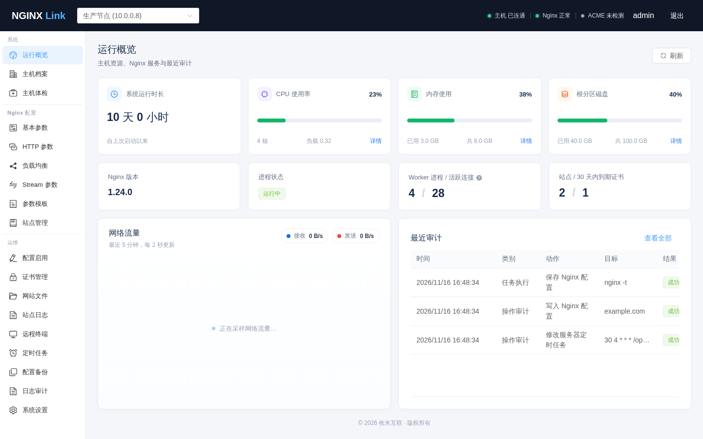
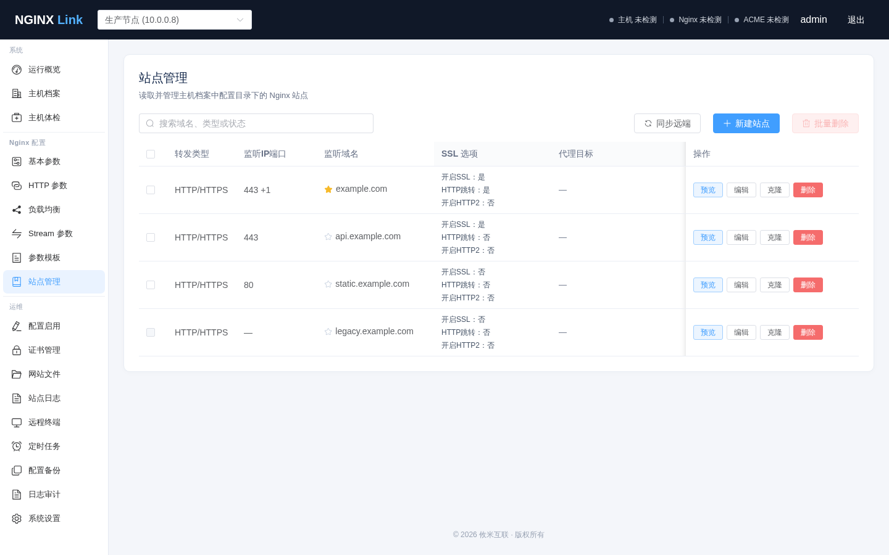
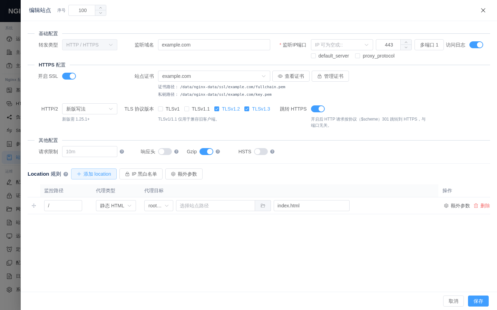
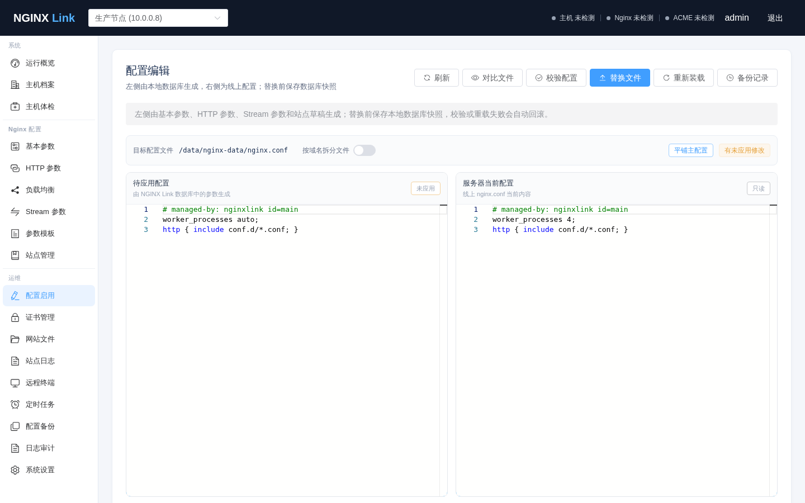
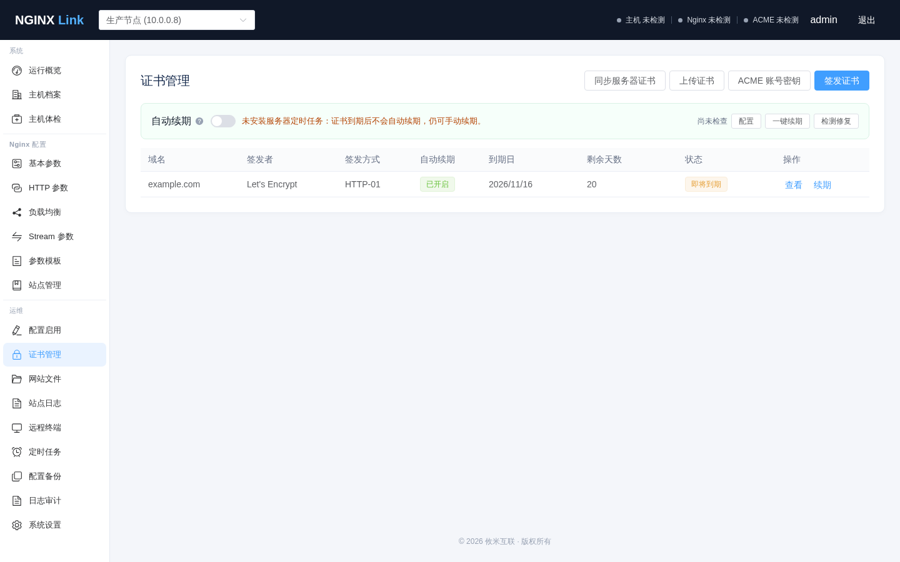
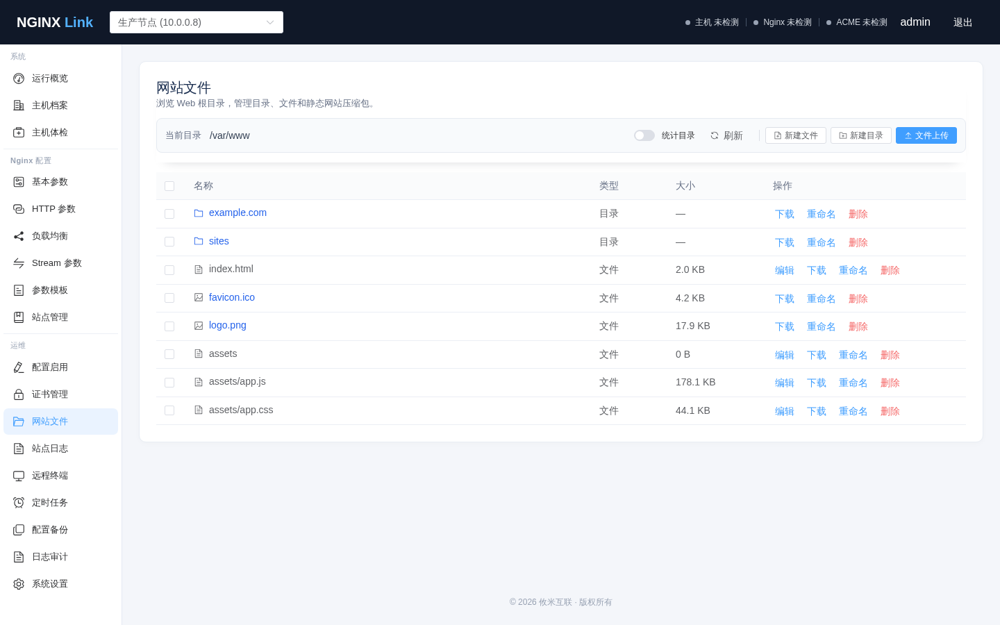
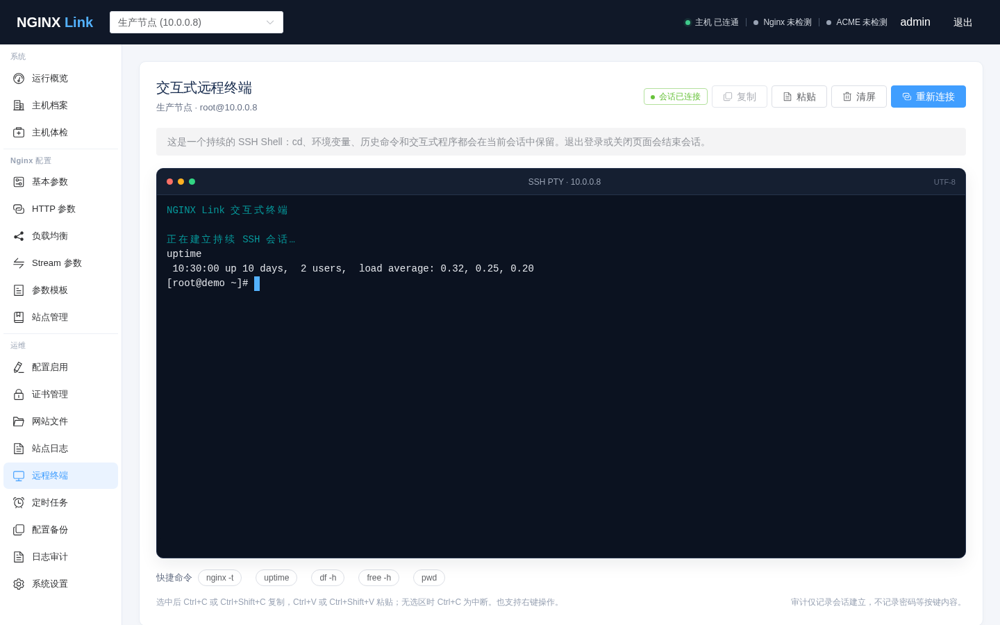

# NGINX Link

Nginx 可视化远程管理面板：通过 SSH/SFTP 统一管理多台服务器的站点、证书、配置与文件。**被管服务器无需安装任何组件**，NGINX Link 以单二进制运行在本地或任意一台管理机上。

完全免费，可管理的服务器数量没有上限，无任何使用限制。本仓库提供各平台编译好的二进制与使用文档。

## 安全设计

- **数据不出域**：主机凭据、站点配置、审计日志全部保存在本地面板的内置 SQLite 中，只存在于你运行它的这台机器上，不经过任何第三方服务器
- **不收集任何信息**：无遥测、无统计、无任何形式的数据上报；程序对外的唯一网络连接是你主动添加的服务器的 SSH 端口
- **内网可用**：纯本地单二进制，不依赖任何外部服务，完全断开外网也能正常管理内网服务器
- **改动可回滚**：远端配置变更前自动备份，`nginx -t` 校验失败自动回滚，全程操作留痕

## 功能特性

- **多主机管理**：主机档案集中维护 SSH 连接，顶栏一键切换；连接诊断区分主机连通与 Nginx 可用性
- **站点管理**：静态站 / SPA / 反向代理 / 负载均衡 / TCP·UDP 转发，可视化编辑 Location、证书、多端口监听，同步远端已有配置
- **配置启用**：本地生成的配置与线上实时对比，`nginx -t` 校验后应用，失败自动回滚；支持按域名拆分文件
- **证书管理**：ACME（Let's Encrypt / ZeroSSL）签发，HTTP-01 / DNS-01（含腾讯云等国内厂商），自动续期与服务器 cron 集成
- **网站文件**：Web 根目录浏览、编辑、上传（文件/目录混合拖拽）、压缩解压、下载、图片在线预览
- **交互式终端**：完整 SSH Shell 会话，支持复制粘贴与快捷命令
- **运维工具**：站点日志（实时跟随/轮转/历史归档）、服务器定时任务、配置备份、日志审计、主机体检、负载与资源概览

## 界面截图

> 截图中的服务器与域名均为虚构示例。















## 下载

在 [Releases](../../releases) 页面下载对应平台的压缩包：

| 文件 | 平台 | 说明 |
| --- | --- | --- |
| `nginxlink-vX.Y.Z-darwin-arm64-gui.tar.gz` | macOS（Apple 芯片） | 图形界面版，菜单栏托盘 |
| `nginxlink-vX.Y.Z-linux-amd64.tar.gz` | Linux 服务器（x86_64） | 普通版，命令行运行 |
| `nginxlink-vX.Y.Z-windows-amd64-gui.zip` | Windows | 图形界面版，系统托盘 |

## 快速开始

解压后直接运行可执行文件，默认监听 8080 端口：

```bash
./nginxlink      # Linux / macOS
nginxlink.exe    # Windows
```

浏览器访问 http://127.0.0.1:8080 ，首次登录默认账号 `admin / admin`，登录后请立即修改密码。

指定其他端口：`./nginxlink -listen 127.0.0.1:9000`（仅本机可访问时推荐绑定 127.0.0.1）。

## 使用流程

1. **主机档案**：新建档案，填写服务器 IP、SSH 端口与账号（密码或密钥），选择安装形态（系统安装 / Docker）
2. **初始化同步**：首次连接后可一键同步远端已有站点、基础参数与负载均衡；也可从空白配置开始
3. **站点 / 参数编辑**：在界面中编辑站点、HTTP 参数、证书等，保存进入「待应用配置」
4. **配置启用**：左侧为待应用配置、右侧为线上配置，确认差异后一键替换——自动 `nginx -t` 校验，失败回滚
5. **日常运维**：日志查看、文件上传、定时任务、证书续期等都在对应菜单中完成

## 说明

- 数据存储：本地面板使用内置 SQLite，远端改动前自动备份，可随时回滚
- 安全：SSH 凭据仅保存在本地数据库；操作留痕可在「日志审计」查看
- 系统要求：被管服务器需已安装 Nginx（或 Docker 形态的 Nginx 容器）；签发证书需服务器已安装 acme.sh

## 支持项目

NGINX Link 完全免费、可管理的服务器数量没有上限、无任何使用限制，也不收集任何信息。如果它帮你节省了时间，欢迎微信扫码请作者吃碗面条 🍜，金额随意，感谢支持！

| 收款码 ① | 收款码 ② | 收款码 ③ |
| --- | --- | --- |
|  |  |  |

## 版权

© 攸米互联 · 版权所有
